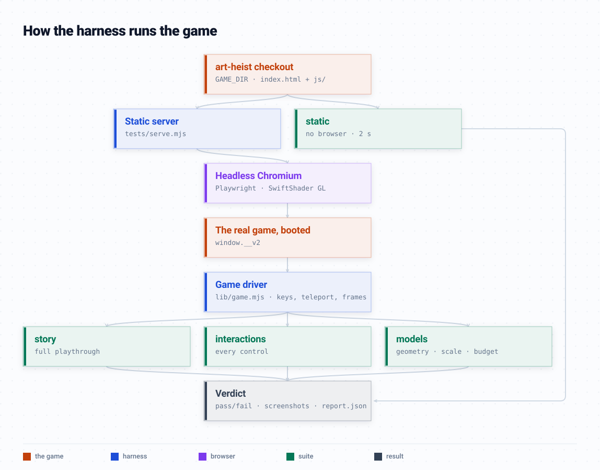
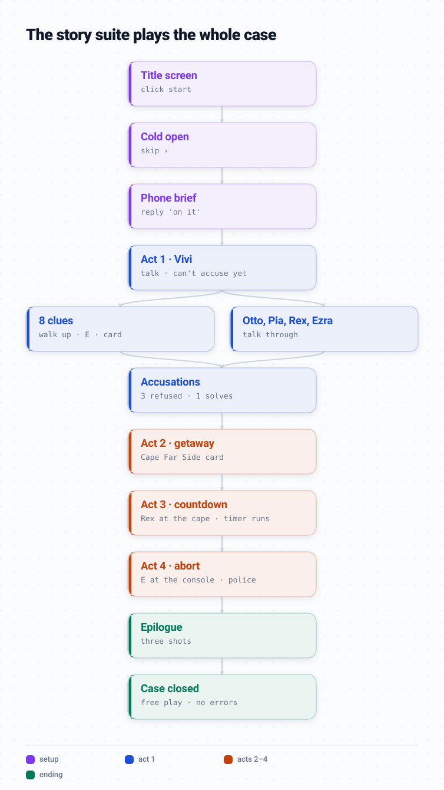

# 3js_test_harness — tests for The Vanishing Gallery

Regression tests for [ghanemja/art-heist](https://github.com/ghanemja/art-heist)'s main app (`index.html` → `js/`). They boot the **real game** in headless
Chromium and play it the way a person would (keys, clicks, walking up to things), so a
change that breaks the story, a control or a model fails here before it reaches `main`.

How it's put together, and why it's built this way (with references to ISTQB game testing,
ISO/IEC/IEEE 29119 and published studio practice): [`METHODOLOGY.md`](METHODOLOGY.md).

## How it works



The harness serves your game checkout, boots it in a headless browser, and drives it through
`lib/game.mjs` — the same keys and clicks a player uses, plus a few shortcuts (standing the critic
next to a clue instead of walking there). The **static** suite skips the browser entirely and reads
the source. Every suite ends in one verdict: pass/fail, screenshots, and a JSON report of what it measured.



The **story** suite is one continuous playthrough, in order — each act only starts if the one before
it really advanced the game, so a break shows up at the exact step that stopped working.

Diagrams are drawn with [modelviz](https://github.com/ghanemja/visme) from the specs in
`docs/diagrams/*.json`; redraw with `python3 docs/diagrams/build.py` (visme checked out next to this repo).

## Setup

Check this repo out **next to** the game (or point `GAME_DIR` at it):

```bash
git clone https://github.com/ghanemja/art-heist
git clone https://github.com/ghanemja/3js_test_harness
cd 3js_test_harness
npm install && npx playwright install chromium
```

```bash
GAME_DIR=/path/to/art-heist node tests/run.mjs   # if the game is somewhere else
```

The harness serves the game folder itself (a tiny static server), so whatever is checked out there — `main`, or a feature branch — is what gets tested.

## Running

```bash
node tests/run.mjs                 # everything (~15 min: the browser renders in software)
node tests/run.mjs static          # no-browser checks only (seconds) — run on every edit
node tests/run.mjs story           # one suite (static | story | interactions | models | rules | rigs)
node --test tests/story.test.mjs   # same thing, plain node:test
```

Needs Node 20+ and Playwright's Chromium. Nothing is added to the game repo, so its Netlify build is unchanged.
Screenshots and a JSON report of every measurement land in `tests/output/` (gitignored).

## What each suite covers

| suite | what it proves | catches |
|---|---|---|
| **static** | every module parses; every relative import names a real file *and* a real export; the import map lists every module on main.js's `?cb=` token; every model/texture/font path in the code exists; every artwork image exists; no shipped GLB over 6 MB; the Netlify build gates pass | a typo'd import, a forgotten import-map entry, a stale cache token, a renamed/deleted asset |
| **story** | the case's data is consistent (culprit is a suspect with ≥2 proving clues, every clue/person exists in the world, has a portrait/sketch); `judge()` accepts *only* the culprit backed by two proving clues (every suspect × every pair); then a **full playthrough**: title → cold open → phone → Vivi → all 8 clues → all suspects + Ezra → three wrong accusations refused → right one → getaway → Rex at the cape → countdown runs → abort at the console → police → epilogue → "Case closed" | a clue that can't be reached, a story step that no longer advances, an accusation rule that changed, a dead end |
| **interactions** | WASD walks, Shift runs, the critic stays on the ground; N notebook, B backpack, P phone, M sound, H hints, Esc, the case-board fold; get in/drive/get out of the car; boat in/out; the museum door in and back out; a project building's card; the phone-width layout keeps its buttons on screen | a dead key, a panel that won't close, a vehicle you can't leave, a door that traps you |
| **rules** | **the game's own house rules** (CLAUDE.md, AGENTS.md, lessons from FEATURE_LOG), checked against the live world: nothing floats, everyone's feet on the floor, roads go round reserved ground, no plant on a road, story people clear of roads and buildings, road grades, no critic clones, idle life, ink on everything, smooth and matte (no flat shading, no shine), the car stays on the road at full lock, the camera never goes underground, play opens facing the museum, no emoji, touch tap targets — see [`RULES.md`](RULES.md) | a floating prop, a road through a building, a plant in the street, a shiny material, an emoji, a regression of any lesson the log records |
| **rigs** | **gait and rigging** for every rigged person in town (toured, so far-away life is checked too): finite bones, no stretched limbs, head over hips over feet with the head upright, hands outside the torso, a golf club in both hands; walking and running: feet alternate, no moonwalk, legs swing front-to-back, feet at the ground | a broken pose, a limb through the body, a moonwalk, legs splaying sideways, a swimmer or golfer gone wrong |
| **models** | no mesh has NaN/infinite geometry; the critic at her scale with feet on the ground; story people at a sane height, feet on the ground (or the bench), under the 6k-tri budget (AGENTS.md); landmarks + story items + scene cost compared to `tests/baseline/scene.json`; review screenshots | a model that vanished, a person floating or sunk, a 3× triangle blow-up, a broken transform |

Every browser suite also fails on **any page error, `console.error`, or failed request** (a 404'd model).

**Reviewed exceptions.** Some things are meant to break a rule: bunting hangs in the air, a cyclist's feet
are on the pedals. Those are listed with a reason in [`tests/baseline/exceptions.json`](tests/baseline/exceptions.json),
each checked in a screenshot first. A listed one passes, a new offender fails, and a listed one that no longer
happens is reported so the list can be pruned. Entries marked **OPEN** are real findings waiting on a decision.
After a deliberate change: `UPDATE_EXCEPTIONS=1 node --test tests/rules.test.mjs`, then write a `why` for every new entry.

## When a test fails because you *meant* the change

- New building / bigger model / removed landmark → re-record the scene baseline and commit it:
  `UPDATE_BASELINE=1 node --test tests/models.test.mjs`
- Story changed (new clue, new suspect, different solution) → update the playthrough in
  `story.test.mjs` (the accusation picks and the act checks) in the same commit.

## How it drives the game

`tests/lib/game.mjs` boots the page and gives tests a small vocabulary: `startPlay()`,
`goTo('vivi')` (stand at a person/clue, returns the E prompt), `press('KeyE')`, `teleport(dir)`,
`frames(n)`, `state()` (act, ui, found clues…), `shot(name)`. It reads the game through
`window.__v2` (set in the game's `js/main.js`) and three read-only peeks on the game object
(`consoleDir`, `boatSpot`, `countdown` — added to the game's `js/game.js` for this harness).

Headless Chromium draws with SwiftShader — seconds per frame of the full town — so between
screenshots the harness switches `renderer.render` off (`fast()`); the game's own loop,
logic, AI and timers keep running at full speed.

## Not automated (still needs eyes)

Does it *look* right (the ink, the hand-drawn feel, faces up close — see AGENTS.md rule 12),
does it *feel* right (camera, pacing), and real-device performance. The screenshots in
`tests/output/` are there to make that look quick.
